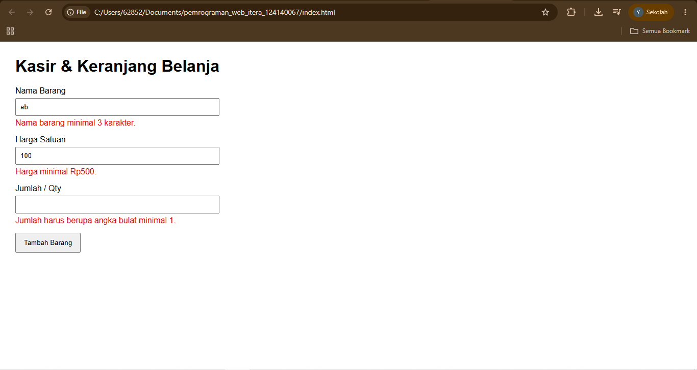
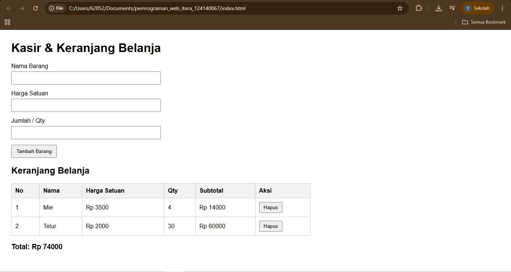
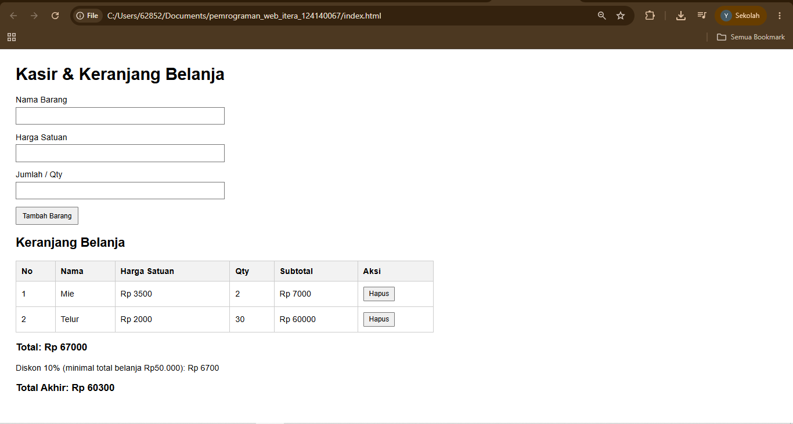
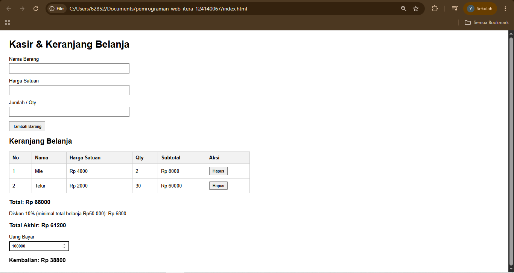
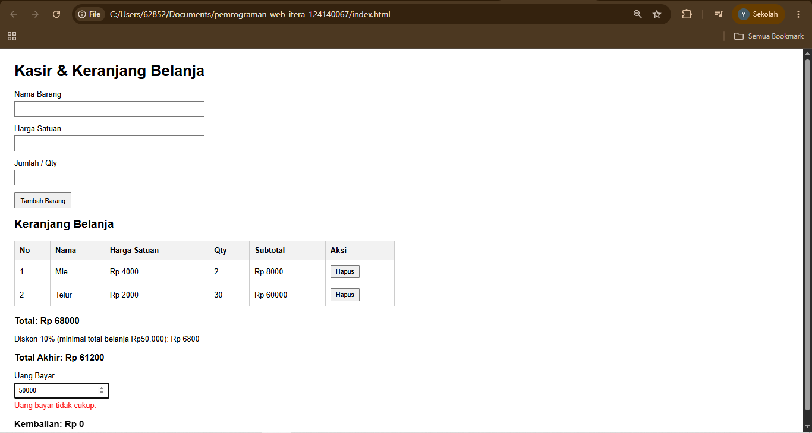
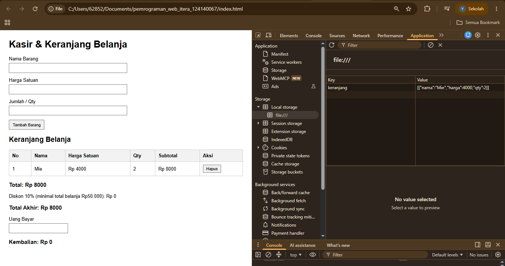
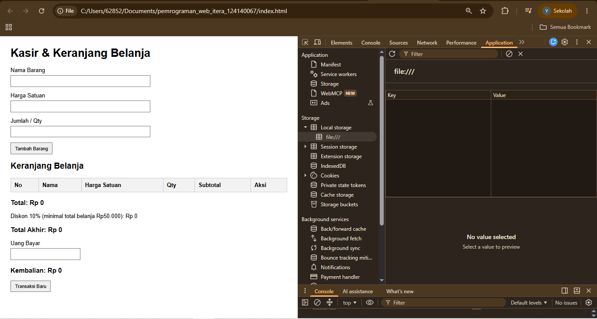

# Mini POS - Kasir & Keranjang Belanja

## Identitas

- **Nama:** Yabes Situmorang
- **NIM:** 124140067
- **Kelas Praktikum:** RB

## Deskripsi Aplikasi

Mini POS adalah aplikasi web sederhana untuk membantu proses transaksi
kasir pada kantin atau toko. Aplikasi ini memungkinkan pengguna
menambahkan barang ke dalam keranjang, menghitung subtotal dan total
belanja, memberikan diskon, menghitung pembayaran dan kembalian, serta
menyimpan data keranjang menggunakan localStorage.

Aplikasi dibuat menggunakan HTML, CSS, dan JavaScript.

## Cara Menjalankan

1. Buka folder project di Visual Studio Code.
2. Pastikan file `index.html`, `style.css`, dan `script.js` berada
   dalam folder yang sama.
3. Buka `index.html` menggunakan browser atau Live Server.
4. Aplikasi Mini POS siap digunakan.

## Fitur

- [x] Validasi nama barang minimal 3 karakter
- [x] Validasi harga satuan minimal Rp500
- [x] Validasi Qty berupa angka bulat minimal 1
- [x] Menambahkan barang ke keranjang
- [x] Menghitung subtotal otomatis
- [x] Menghitung total belanja otomatis
- [x] Diskon 10% untuk total belanja minimal Rp50.000
- [x] Menghitung total akhir setelah diskon
- [x] Menghitung kembalian secara otomatis
- [x] Menampilkan pesan jika uang pembayaran tidak cukup
- [x] Menghapus barang dari keranjang
- [x] Menyimpan keranjang menggunakan localStorage
- [x] Memuat kembali keranjang setelah halaman di-refresh
- [x] Tombol Transaksi Baru untuk mengosongkan keranjang

## Screenshot

### 1. Validasi Input

Menampilkan pesan peringatan ketika input tidak diisi atau tidak sesuai.

### 2. Hasil Perhitungan Kalkulator

Menampilkan barang yang telah dimasukkan ke dalam keranjang beserta subtotal dan total belanja.

### 3. Tampilan Nominal Diskon

Menampilkan diskon 10% ketika total belanja memenuhi ketentuan.

### 4. Kalkulator Pembayaran dan Kembalian

Menampilkan perhitungan kembalian berdasarkan uang yang dibayarkan dan total akhir.

### 5. Uang Tidak Cukup untuk Bayar

Menampilkan peringatan ketika uang yang dibayarkan kurang dari total akhir.

### 6. Penyimpanan Persistent (localStorage)

Menampilkan bahwa data keranjang tetap tersimpan setelah halaman di-refresh.

### 7. Transaksi Baru

Menampilkan kondisi setelah tombol Transaksi Baru ditekan.

## Penjelasan Teknis

### 1. Validasi Input

Validasi input dilakukan menggunakan JavaScript sebelum barang dimasukkan ke dalam keranjang. Nama barang wajib diisi dan memiliki minimal 3 karakter. Harga satuan harus berupa angka dengan nilai minimal Rp500. Qty harus berupa bilangan bulat dengan nilai minimal 1. Jika terdapat data yang tidak valid, sistem menampilkan pesan peringatan berwarna merah dan barang tidak dimasukkan ke dalam keranjang.

### 2. Perhitungan Transaksi

Setiap barang memiliki subtotal yang dihitung dengan rumus:

Sub Total = Harga satuan x Jumlah barang

Total belanja merupakan penjumlahan seluruh subtotal barang di dalam keranjang.

Jika total belanja mencapai minimal Rp50.000, sistem memberikan diskon sebesar 10%. Total akhir dihitung dengan mengurangi total belanja dengan nilai diskon.

### 3. Pembayaran dan Kembalian

Pengguna dapat memasukkan jumlah uang yang dibayarkan. Sistem membandingkan uang bayar dengan total akhir transaksi. Jika uang bayar mencukupi, sistem menghitung kembalian dengan rumus:

Kembalian = Uang Bayar - Total Akhir

Jika uang bayar kurang dari total akhir, sistem menampilkan pesan bahwa uang pembayaran tidak cukup.

### 4. Keranjang dan localStorage

Data barang yang terdapat di dalam keranjang disimpan menggunakan localStorage. Data array keranjang diubah menjadi format JSON menggunakan JSON.stringify() sebelum disimpan.

Ketika halaman dibuka kembali atau di-refresh, data dari localStorage diambil menggunakan localStorage.getItem() dan dikembalikan menjadi array menggunakan JSON.parse(). Dengan demikian, data keranjang tetap tersedia setelah halaman di-refresh.

### 5. Transaksi Baru

Tombol Transaksi Baru digunakan untuk mengosongkan keranjang dan menghapus data keranjang dari localStorage. Form input, uang bayar, pesan kesalahan, dan kembalian juga dikembalikan ke kondisi awal.
