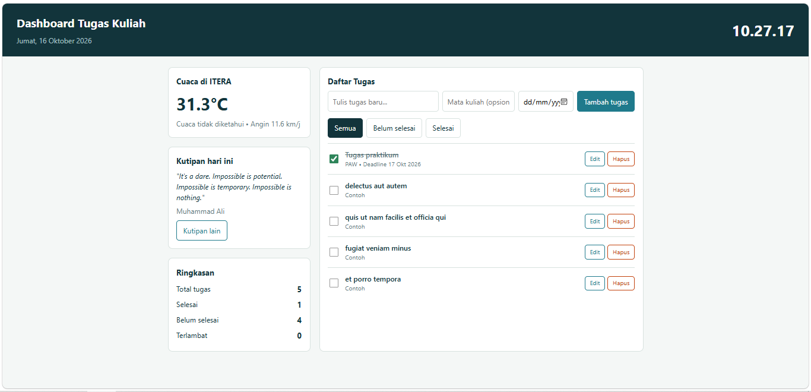

# Dashboard Tugas Kuliah

**Nama:** Yabes Situmorang   
**NIM:** 124140067   
**Kelas:** RB  
**Tugas:** Personal Dashboard - Pertemuan 2 (JavaScript ES6+)

## Penjelasan Aplikasi

Dashboard Tugas Kuliah membantu saya mencatat dan memantau tugas kuliah sehari-hari dalam satu halaman.

Fitur:
- **Daftar tugas (CRUD):** tambah tugas (judul, mata kuliah, deadline), edit judul, hapus, dan centang selesai.
- **Filter:** tampilkan Semua, Belum selesai, atau Selesai.
- **Penanda terlambat:** tugas yang lewat deadline dan belum selesai diberi label "Terlambat".
- **Ringkasan:** jumlah total, selesai, belum selesai, dan terlambat.
- **Cuaca ITERA:** data real-time dari Open-Meteo.
- **Kutipan harian:** kutipan acak dari DummyJSON, bisa diganti dengan tombol "Kutipan lain".
- **Jam dan tanggal** yang berjalan otomatis.
- **Penyimpanan lokal:** semua tugas disimpan di `localStorage`, jadi tidak hilang saat halaman di-refresh. Saat pertama kali dibuka, 5 tugas contoh diambil dari JSONPlaceholder.

## Cara Menjalankan

Buka file `index.html` di browser (butuh internet untuk cuaca, kutipan, dan tugas contoh).

## Screenshot

## Fitur ES6+ yang Diimplementasikan (file `script.js`)

| Fitur ES6+ | Baris | Keterangan |
|---|---|---|
| `let` | 177 | `let html` diisi nanti sesuai isi daftar tugas |
| `const` | 7, 13, 17, 78, 102, 138-140, 204-206, 217 | Dipakai untuk semua nilai yang tidak diubah ulang |
| Arrow functions | 7, 13, 82, 108, 124, 136, 147, 158, 170, 181, 217 | `escapeHtml`, `formatTanggal`, callback `map`/`filter`, event listener, `tick` |
| Template literals | 179-197, 207-212, 235-238, 250-254 | Render daftar tugas, ringkasan, cuaca, dan kutipan secara dinamis |
| Async/Await | 62, 77, 88-89, 229, 233-234, 245, 248-249 | `init`, `loadTasks`, `loadWeather`, `loadQuote` memakai `fetch` |
| Classes | 24 (`TaskItem`), 48 (`DashboardApp`) | `TaskItem` = model data tugas, `DashboardApp` = state, localStorage, dan fetch |
| Destructuring | 26, 90, 148, 159, 170, 234, 249 | Pada parameter fungsi dan hasil API |
| Spread operator | 36, 103, 117 | Memperbarui array/objek tanpa mengubah aslinya (immutable) |
| Default parameter | 26 | `id`, `course`, `deadline`, `done` punya nilai default |
| Getter | 40 (`isOverdue`) | Mengecek apakah tugas terlambat |
| Nullish coalescing `??` | 238 | Teks cadangan jika kode cuaca tidak dikenal |

## Penggunaan localStorage

- Menyimpan: `saveTasks()` (baris 73-75)
- Membaca: `loadTasks()` (baris 77-99)
- Key: `dashboard_tugas_v1`

## API yang Dipakai

- Cuaca: `https://api.open-meteo.com/v1/forecast?latitude=-5.36&longitude=105.31&current_weather=true`
- Kutipan: `https://dummyjson.com/quotes/random`
- Tugas awal: `https://jsonplaceholder.typicode.com/todos?_limit=5`