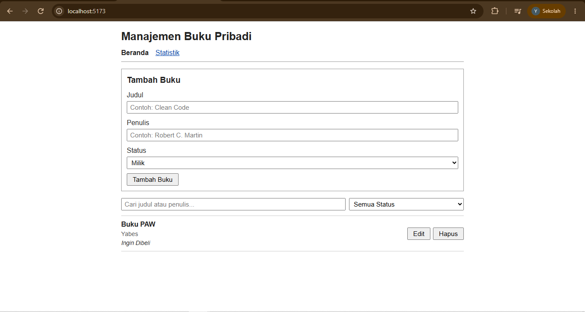
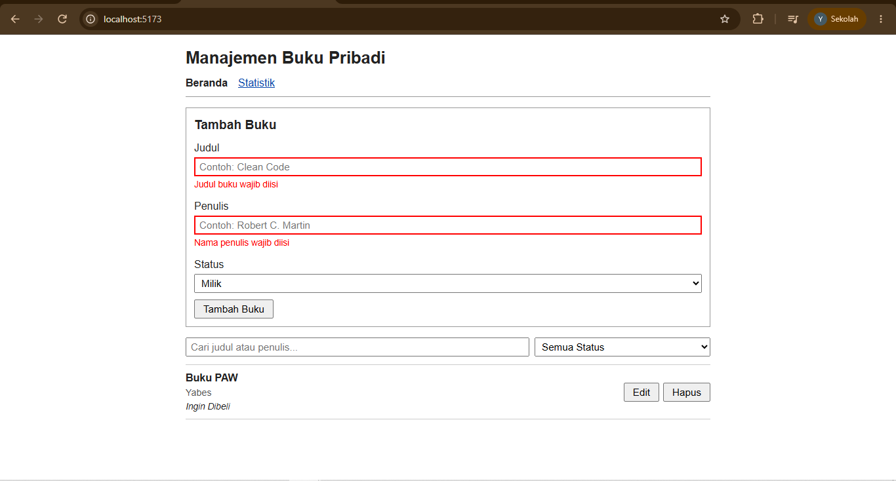
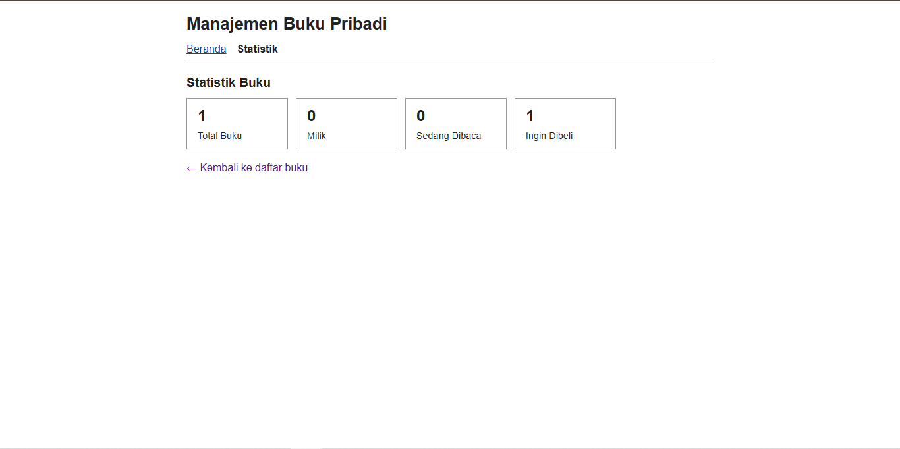

# Aplikasi Manajemen Buku Pribadi

Tugas Praktikum Pengembangan Aplikasi Web (PAW) - Pertemuan 3: React Basics
Teknik Informatika · ITERA

- Nama : Yabes Situmorang
- NIM  : 124140067

## Deskripsi

Aplikasi untuk mencatat buku yang **dimiliki**, **sedang dibaca**, atau **ingin dibeli**.
Data disimpan di `localStorage` sehingga tidak hilang saat halaman di-refresh.

### Fitur
- Menambah buku (judul, penulis, status: milik / baca / beli)
- Mengedit dan menghapus buku
- Filter buku berdasarkan status
- Pencarian buku berdasarkan judul atau nama penulis
- Halaman statistik jumlah buku per status
- Validasi form (kolom wajib diisi, dengan feedback visual dan pesan error)

## Cara Menjalankan (VS Code)

1. Buka folder project ini di VS Code.
2. Buka terminal, lalu jalankan:

```bash
npm install
npm run dev
```

3. Buka alamat yang muncul di terminal (biasanya `http://localhost:5173`).

Menjalankan unit test:

```bash
npm test
```

> Folder `node_modules/` tidak diunggah ke repositori (terdaftar di `.gitignore`).

## Screenshot

### Halaman Beranda


### Validasi Form


### Halaman Statistik


## Fitur React yang Digunakan

| Konsep | Penggunaan |
|---|---|
| `useState` | State form dan error di `BookForm`, buku yang sedang diedit di `Home`, filter dan pencarian di `BookContext`, nilai di `useLocalStorage` |
| `useEffect` | Menyimpan data ke `localStorage` setiap kali berubah (`useLocalStorage`) |
| `useMemo` dan `useCallback` | Menghitung statistik (`useBookStats`) dan