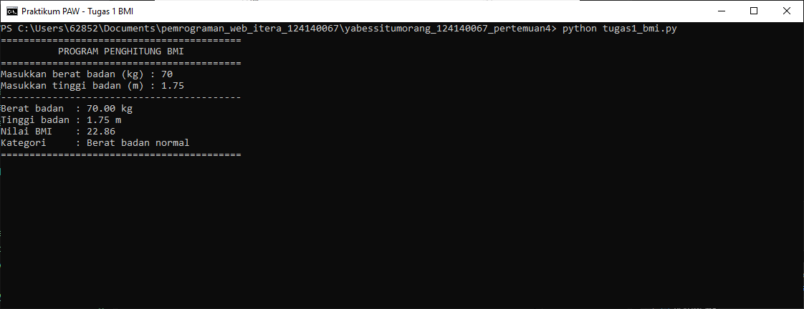
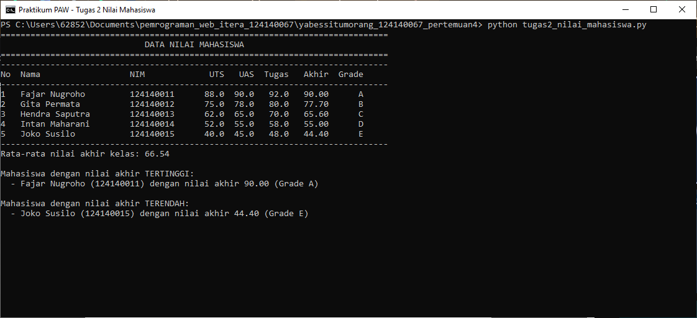
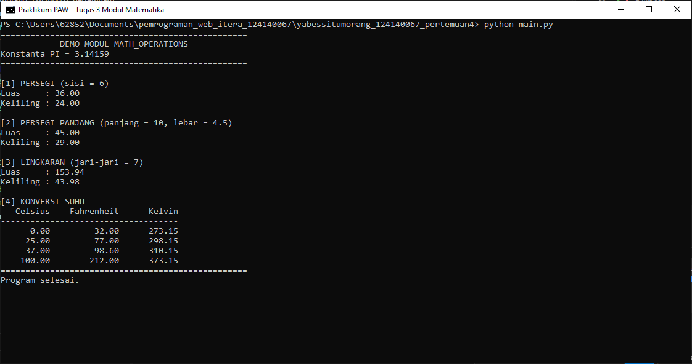

# Laporan Praktikum Pertemuan 4 — Python Dasar

## Identitas Mahasiswa

- **Nama:** Yabes Situmorang
- **NIM:** 124140067

## Deskripsi Program

### 1. `tugas1_bmi.py` — Penghitung BMI

Program meminta berat badan (kg) dan tinggi badan (m) melalui `input()`, lalu menghitung BMI dengan rumus `berat / (tinggi * tinggi)`. Nilai BMI dikategorikan menggunakan `if-elif-else`:

- BMI < 18.5: Berat badan kurang
- 18.5 ≤ BMI < 25: Berat badan normal
- 25 ≤ BMI < 30: Berat badan berlebih
- BMI ≥ 30: Obesitas

Hasil nilai BMI dicetak dengan dua angka desimal beserta kategorinya.

Fungsi: `hitung_bmi()`, `tentukan_kategori()`, `baca_angka()`, `main()`.

### 2. `tugas2_nilai_mahasiswa.py` — Pengelolaan Nilai Mahasiswa

Program menyimpan 5 data mahasiswa dalam list of dictionary dengan kunci `nama`, `nim`, `nilai_uts`, `nilai_uas`, dan `nilai_tugas`. Nilai akhir dihitung dengan rumus `(30% × UTS) + (40% × UAS) + (30% × Tugas)`, lalu ditentukan grade A–E. Seluruh data ditampilkan dalam bentuk tabel, kemudian program mencari dan menampilkan nilai akhir tertinggi dan terendah.

Fungsi: `hitung_nilai_akhir()`, `tentukan_grade()`, `olah_data()`, `buat_tabel()`, `cari_nilai_tertinggi()`, `cari_nilai_terendah()`, `tampilkan_ekstrem()`, `main()`.

### 3. `math_operations.py` dan `main.py` — Modul Matematika

`math_operations.py` menyediakan konstanta `PI`, fungsi luas dan keliling untuk persegi, persegi panjang, dan lingkaran, serta fungsi konversi Celsius ke Fahrenheit dan Celsius ke Kelvin. `main.py` mengimpor modul tersebut menggunakan dua cara (`import math_operations` dan `from math_operations import ...`), memanggil seluruh fungsi, lalu menampilkan hasil kalkulasi.

Fungsi: `luas_persegi()`, `keliling_persegi()`, `luas_persegi_panjang()`, `keliling_persegi_panjang()`, `luas_lingkaran()`, `keliling_lingkaran()`, `celsius_ke_fahrenheit()`, `celsius_ke_kelvin()`.

## Cara Menjalankan

Jalankan perintah berikut di terminal VS Code dari folder `yabessitumorang_124140067_pertemuan4`:

```bash
python tugas1_bmi.py
python tugas2_nilai_mahasiswa.py
python main.py
```

## Screemshot

### Soal 1 — `tugas1_bmi.py`



### Soal 2 — `tugas2_nilai_mahasiswa.py`



### Soal 3 — `main.py`


