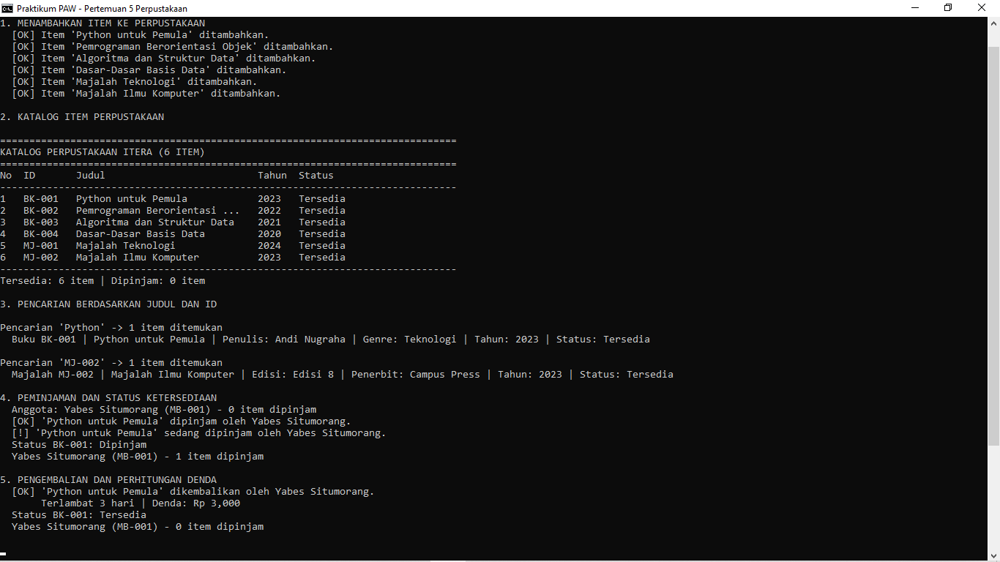

# Laporan Praktikum Pertemuan 5 — Python OOP

## Identitas Mahasiswa

- **Nama:** Yabes Situmorang
- **NIM:** 124140067
- **Kelas:** RB

## Deskripsi Program

Program **Sistem Manajemen Perpustakaan Sederhana** terdiri dari
`library_item.py`, `member.py`, `library.py`, dan `main.py`. Alur program
dimulai dengan membuat objek `Library`, menambahkan beberapa `Book` dan
`Magazine`, menampilkan katalog, mencari item berdasarkan judul atau ID,
meminjam item, lalu mengembalikannya beserta perhitungan denda.

Penerapan empat pilar OOP:

- **Class & Object:** `LibraryItem`, `Book`, `Magazine`, `Member`, dan
  `Library` adalah class yang menghasilkan objek dengan atribut dan method
  masing-masing.
- **Inheritance:** `Book` dan `Magazine` mewarisi abstract class
  `LibraryItem` serta mengimplementasikan method `get_detail()` dan
  `hitung_denda()`.
- **Encapsulation:** koleksi perpustakaan disimpan pada atribut private
  `Library.__koleksi`, status pinjam pada `LibraryItem.__dipinjam`, dan
  identitas anggota pada `Member.__nama`. Akses data dilakukan melalui
  property dan method yang tervalidasi.
- **Polymorphism:** objek `Book` dan `Magazine` disimpan dalam satu koleksi
  `LibraryItem` dan dipanggil melalui method yang sama, yaitu
  `get_detail()` dan `hitung_denda()`, dengan hasil sesuai jenis item.

## Panduan Menjalankan Program

```bash
cd yabessitumorang_124140067_pertemuan5/tugas_perpustakaan
python main.py
```

## Screenshot Output


